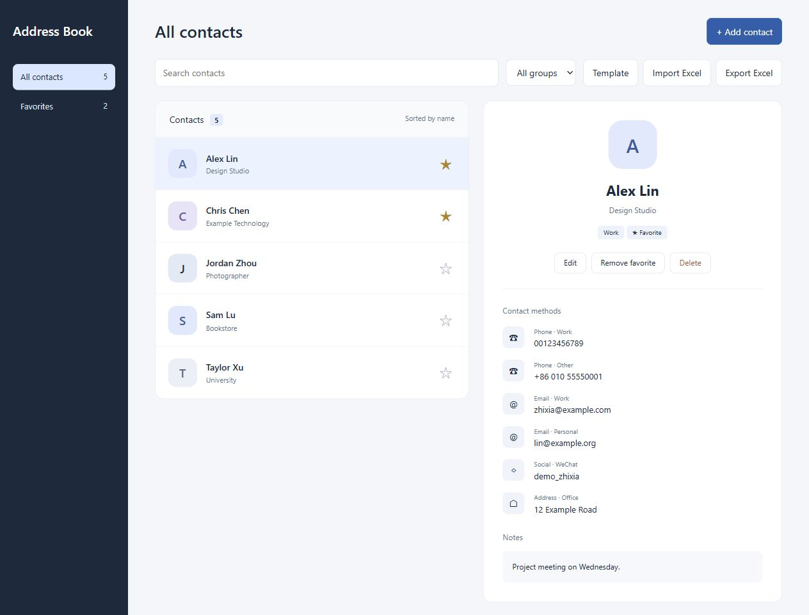
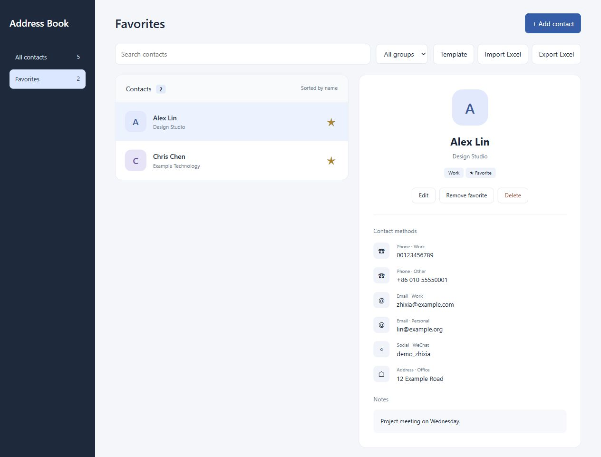
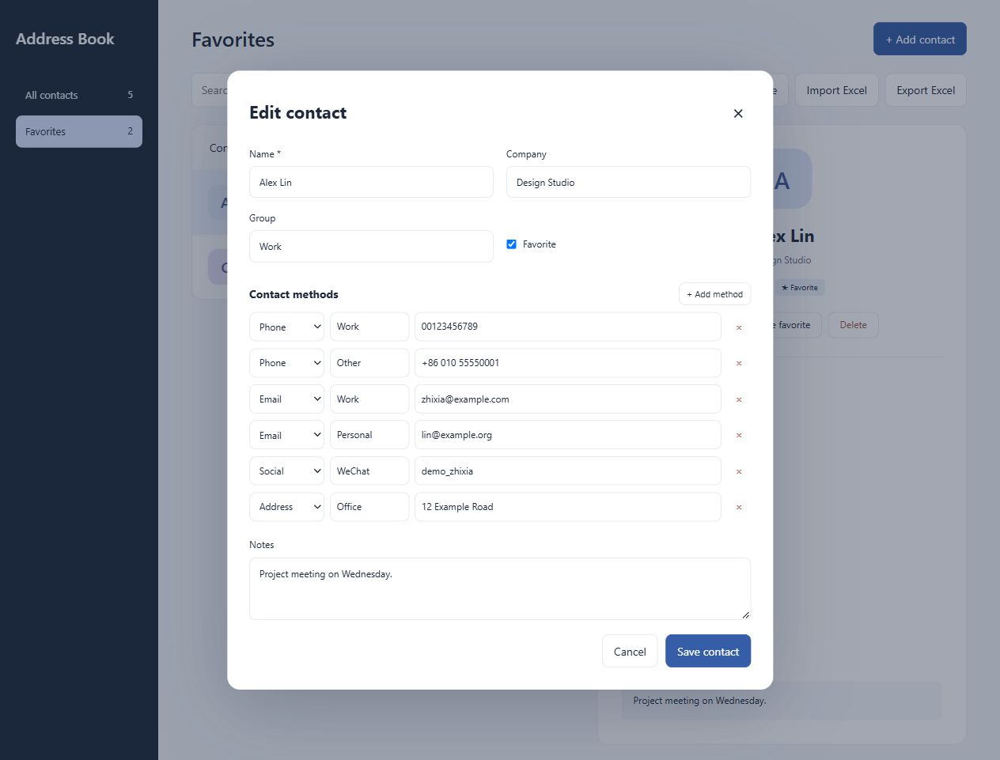

# Extreme Programming: Address Book

> Draft only. Replace placeholders with actual evidence before publishing. Each member publishes an individual personal blog.

| Item | Content |
| --- | --- |
| Course for This Assignment | [2601_FZU-MU_SE](https://bbs.csdn.net/forums/2601_MU_SE_FZU) |
| Team Name | [Team name and this blog's author] |
| Assignment Requirements | [Extreme Programming](https://bbs.csdn.net/topics/620593436) |
| Objectives of This Assignment | Implement address book features and practice pair collaboration, Git and software engineering |
| Other References | [Sources actually used] |

## Contents

- [Project links](#project-links)
- [Implementation](#implementation)
- [Running evidence](#running-evidence)
- [Git contributions](#git-contributions)
- [Responsibilities and contribution ratios](#responsibilities-and-contribution-ratios)
- [Problems and solutions](#problems-and-solutions)
- [PSP records](#psp-records)
- [Acceptance and reflection](#acceptance-and-reflection)

## Project links

| Material | Link |
| --- | --- |
| Team repository | https://github.com/abet64287-crypto/addressBook |
| Specified source repository | [Confirm the course's fork requirement] |
| Standards | https://github.com/abet64287-crypto/addressBook/blob/main/docs/CODING_STANDARDS.md |
| Run instructions | https://github.com/abet64287-crypto/addressBook/blob/main/README.md |
| Release | [Actual version link] |
| PR | [Actual PR link] |
| Complete video | [Accessible recording; not yet recorded] |
| Public application, optional | [Working URL after deployment, or state not deployed] |

## Implementation

The local project uses Python 3.12, Flask 3.0.3, SQLite, openpyxl 3.1.5 and native HTML/CSS/JavaScript. A's contacts/UI and B's five Excel files are uploaded to main. B's upload was made by hajiyao on November 17, 2026 in [0f11165](https://github.com/abet64287-crypto/addressBook/commit/0f1116596844622d09149fe9e157e3df8afcd0cc). The reported 30-test result comes from the complete local A+B implementation on November 16; repeat acceptance on the current checkout.

The factory registers contact endpoints and an Excel Blueprint. Domain validation is shared by forms and spreadsheets. SQLite stores stable IDs and contact data including a favorite boolean and typed, labeled method arrays.

Stars and a separate Favorites view expose saved favorite state. The editor supports multiple phones, emails, social accounts and addresses. Text storage preserves prefixes and leading zeros; individual rows can be added and removed.

Excel uses one row per contact, English base headers and indexed value/label columns. The full workbook is validated before transactionally saving. Exact duplicates are skipped; different records are added without overwrite. Formulas are rejected; exported user values remain text.

The navy/light-gray interface provides a list/detail layout, search, grouping, modal editor and transfer feedback. Narrow-screen styles exist; phone-device acceptance has not been performed.

## Running evidence

These images come from the running local app. Upload them to CSDN and replace paths before publishing. Workbook/import images remain to be added.

Complete demonstration video: [Link or embed]. Screenshots do not replace the required full recording.

## Git contributions

[Insert actual history screenshots with author identities. State the baseline-to-release scope, treatment of merges and any inherited history excluded.]

| Member | GitHub username | Actual assignment commits | Representative commits |
| --- | --- | ---: | --- |
| A | abet64287-crypto [confirm] | [Final count] | [Links] |
| B | [Username] | [Actual count] | [Links] |

## Responsibilities and contribution ratios

| Member | Actual work and evidence | Contribution |
| --- | --- | ---: |
| A | [Complete] | [Value]% |
| B | [Complete] | [Value]% |
| Total | | 100% |

Explain percentages using actual implementation, integration, review, verification and documentation. Commit count alone is not a percentage.

## Problems and solutions

### Member A

[Actual problem, cause, solution, verification and evidence.]

### Member B

[Actual problem, cause, solution, verification and evidence.]

## PSP records

Use minutes. Estimate before work and record actual time afterward; do not reconstruct estimates as if recorded earlier. Use a course-supplied table if required. Subtotals sum child rows; the grand total must not double-count subtotals.

### Member A: [Name]

| PSP 2.1 | Activity | Estimated minutes | Actual minutes |
| --- | --- | ---: | ---: |
| Planning | Planning subtotal | [Complete] | [Complete] |
| Estimate | Effort estimate and plan | [Complete] | [Complete] |
| Development | Development subtotal | [Complete] | [Complete] |
| Analysis | Requirements analysis | [Complete] | [Complete] |
| Design Spec | Design document | [Complete] | [Complete] |
| Design Review | Design review | [Complete] | [Complete] |
| Coding Standard | Coding standards | [Complete] | [Complete] |
| Design | Detailed design | [Complete] | [Complete] |
| Coding | Implementation | [Complete] | [Complete] |
| Code Review | Code review | [Complete] | [Complete] |
| Test | Testing and fixes | [Complete] | [Complete] |
| Reporting | Reporting subtotal | [Complete] | [Complete] |
| Test Report | Test report | [Complete] | [Complete] |
| Size Measurement | Work measurement | [Complete] | [Complete] |
| Postmortem & Process Improvement Plan | Retrospective and improvements | [Complete] | [Complete] |
| Total | Planning + Development + Reporting | [Complete] | [Complete] |

### Member B: [Name]

| PSP 2.1 | Activity | Estimated minutes | Actual minutes |
| --- | --- | ---: | ---: |
| Planning | Planning subtotal | [Complete] | [Complete] |
| Estimate | Effort estimate and plan | [Complete] | [Complete] |
| Development | Development subtotal | [Complete] | [Complete] |
| Analysis | Requirements analysis | [Complete] | [Complete] |
| Design Spec | Design document | [Complete] | [Complete] |
| Design Review | Design review | [Complete] | [Complete] |
| Coding Standard | Coding standards | [Complete] | [Complete] |
| Design | Detailed design | [Complete] | [Complete] |
| Coding | Implementation | [Complete] | [Complete] |
| Code Review | Code review | [Complete] | [Complete] |
| Test | Testing and fixes | [Complete] | [Complete] |
| Reporting | Reporting subtotal | [Complete] | [Complete] |
| Test Report | Test report | [Complete] | [Complete] |
| Size Measurement | Work measurement | [Complete] | [Complete] |
| Postmortem & Process Improvement Plan | Retrospective and improvements | [Complete] | [Complete] |
| Total | Planning + Development + Reporting | [Complete] | [Complete] |

## Acceptance and reflection

On November 16, 2026, the combined local packages passed 30 tests on Windows / Python 3.12.7. Both JavaScript syntax checks passed. Browser checks covered favorite filtering, methods, saving, template download and empty-template import. See TEST_REPORT.md.

The Excel upload is complete. Current-checkout acceptance, complete video, public deployment, the required PR, Release and final blog submissions are pending. [Add this author's actual reflection and personal problem records.]
